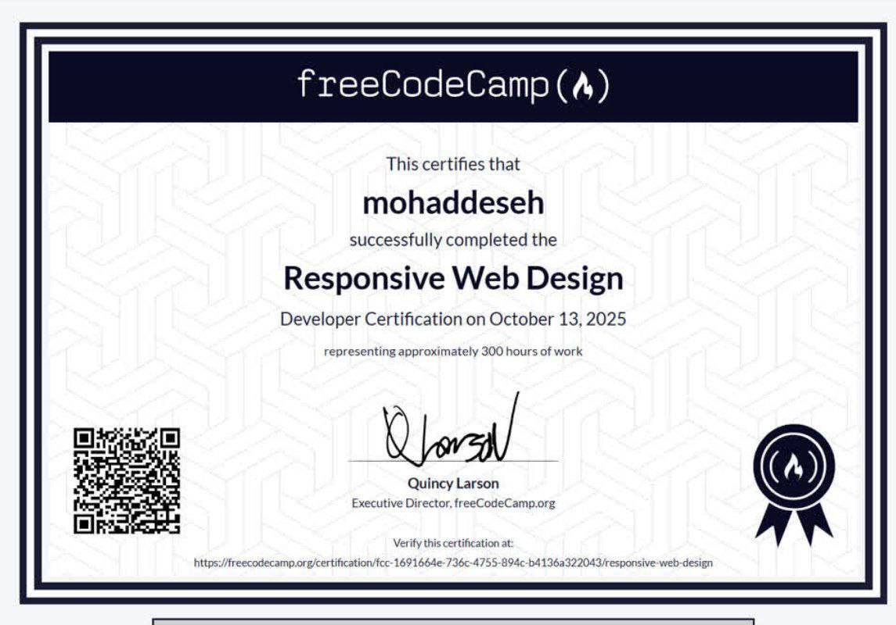

# freecodecamp-projects

# 🖋️ Biography-Ferdowsi

> صفحه‌ی بزرگداشت ابوالقاسم فردوسی، شاعر اسطوره‌ای ایران و خالق شاهنامه.

---

## 📖 درباره‌ی پروژه

این پروژه یک صفحه‌ی ساده، تمیز و واکنش‌گرا برای بزرگداشت **فردوسی**، یکی از بزرگ‌ترین شاعران تاریخ ایران است. این صفحه بیوگرافی او را در قالبی منظم و خوانا با یک تصویر شاخص و نمونه‌ای از اشعارش ارائه می‌دهد.

این صفحه با **HTML** و **CSS** خالص ساخته شده و برای بارگذاری سریع و سبک طراحی شده است.

---

## ✨ ویژگی‌ها

- 📜 **بیوگرافی کامل** فردوسی در ۱۲ بخش
- 🖼️ **تصویر شاخص** با توضیحات
- 📝 **نمونه شعر** از فردوسی
- 🔗 **لینک خارجی** به ویکی‌پدیا برای اطلاعات بیشتر
- 🎨 **طراحی مینیمال** با پالت رنگی گرم و ملایم
- 📱 **واکنش‌گرا** و خوانا در تمام دستگاه‌ها

---

# 🧑‍💻 finaly-all-project

> صفحه‌ی نمونه کار شخصی برای نمایش پروژه‌های freeCodeCamp با طراحی مدرن و تمیز.

---

## 📖 درباره‌ی پروژه

این یک صفحه‌ی نمونه کار شخصی است که برای نمایش مجموعه‌ای از پروژه‌های من در قالبی زیبا و گریدی طراحی شده است. این صفحه شامل نوار ناوبری ثابت، بخش خوش‌آمدگویی و کارت‌های پروژه با تصاویر و لینک‌ها است.

طراحی کاملاً واکنش‌گرا است و هم روی دسکتاپ و هم روی موبایل به‌خوبی کار می‌کند.

---

## ✨ ویژگی‌ها

- 🧭 **نوار ناوبری ثابت** با اسکرول نرم
- 👋 **بخش خوش‌آمدگویی** با ارتفاع کامل صفحه
- 🗂️ **گالری پروژه‌ها** با افکت هاور (hover)
- 🔗 **لینک پروفایل گیت‌هاب** در پایین صفحه
- 🎨 **هدر گرادیان مدرن** و تایپوگرافی تمیز
- 📱 **طراحی واکنش‌گرا** برای تمام اندازه‌های صفحه

---

# 📝 Information-form

> فرم ساده و قابل‌دسترس برای جمع‌آوری اطلاعات شخصی و رزومه.

---

## 📖 درباره‌ی پروژه

این پروژه یک فرم HTML ساده و کاربردی است که برای جمع‌آوری اطلاعات کاربر از جمله نام، ایمیل، سن، جنسیت، سطح تحصیلات و رزومه طراحی شده است. این فرم از HTML معنایی استفاده می‌کند و با پالت رنگی تیره و مدرن استایل‌دهی شده است.

این فرم برای استفاده در پورتال‌های شغلی، صفحات ثبت‌نام یا هر برنامه‌ای که نیاز به جمع‌آوری اطلاعات کاربر دارد، عالی است.

---

## ✨ ویژگی‌ها

- 📋 **فیلدهای کامل فرم**: نام، نام‌خانوادگی، ایمیل، سن
- 🚻 **انتخاب جنسیت** با دکمه‌های رادیویی
- 🎓 **منوی کشویی سطح تحصیلات** (کارشناسی، کارشناسی ارشد، دکتری، سایر)
- 📄 **محل نوشتن رزومه** برای ورود توضیحات دقیق
- ✅ **اعتبارسنجی فیلدهای اجباری** (نام، ایمیل)
- 🎨 **تم تیره** با کنتراست بالا و خوانایی عالی
- 📱 **چیدمان واکنش‌گرا** که در تمام دستگاه‌ها کار می‌کند

---

# 📘 Introduction_to_Git_GitHub

> صفحه‌ی مستندات فنی جامع برای آموزش اصول اولیه‌ی گیت و گیت‌هاب به مبتدیان.

---

## 📖 درباره‌ی پروژه

این پروژه یک صفحه‌ی مستندات فنی است که به‌عنوان راهنمای دوستانه برای مبتدیان در زمینه‌ی **گیت** و **گیت‌هاب** طراحی شده است. این صفحه مباحث ضروری از جمله نصب، دستورات پایه، برنچینگ، ادغام و ویژگی‌های کلیدی گیت‌هاب را پوشش می‌دهد.

این صفحه دارای ناوبری کناری ثابت و چیدمان تمیز و خوانا است – برای یادگیری یا به‌عنوان مرجع سریع ایده‌آل است.

---

## ✨ ویژگی‌ها

- 📑 **ناوبری کناری** با موقعیت ثابت برای دسترسی آسان
- 📚 **۵ بخش اصلی**: مقدمه، نصب گیت، دستورات پایه، برنچینگ و ادغام، ویژگی‌های گیت‌هاب
- 💻 **قطعه‌کدهای نمونه** با مثال‌های واقعی
- 📋 **لیست‌های گلوله‌ای** برای مرور سریع دستورات
- 🎨 **طراحی مینیمال** با خوانایی بالا
- 📱 **واکنش‌گرا** برای موبایل و تبلت

---

# 📱 S25-Ultra

> صفحه‌ی فرود محصول برای سامسونگ گلکسی S25 اولترا، شامل نمایش ویژگی‌ها، مشخصات و فرم پیش‌خرید.

---

## 📖 درباره‌ی پروژه

این یک صفحه‌ی فرود مدرن برای **سامسونگ گلکسی S25 اولترا** است که شامل هدر ثابت با ناوبری، ویدئوی تبلیغاتی جاسازی‌شده، بخش ویژگی‌ها و فرم پیش‌خرید می‌باشد.

طراحی تمیز، حرفه‌ای و کاملاً واکنش‌گرا است و برای کمپین‌های بازاریابی یا تبلیغاتی مناسب می‌باشد.

---

## ✨ ویژگی‌ها

- 🧭 **نوار ناوبری ثابت** با اسکرول نرم
- 🎥 **ویدئوی جاسازی‌شده** (محتوای تبلیغاتی)
- 📋 **بخش ویژگی‌ها** با نکات کلیدی
- 📊 **بخش مشخصات** برای جزئیات فنی
- 📧 **فرم ثبت‌نام ایمیل** برای پیش‌خرید
- 🎨 **طراحی مینیمال** با برند سامسونگ
- 📱 **واکنش‌گرا** برای موبایل، تبلت و دسکتاپ

---
## 🏅 certificates

من دوره‌های زیر را در **freeCodeCamp** با موفقیت به پایان رسانده‌ام:

برای مشاهده‌ی گواهینامه به‌صورت کامل، [اینجا](./certificates/certificates.jpg) کلیک کنید.
